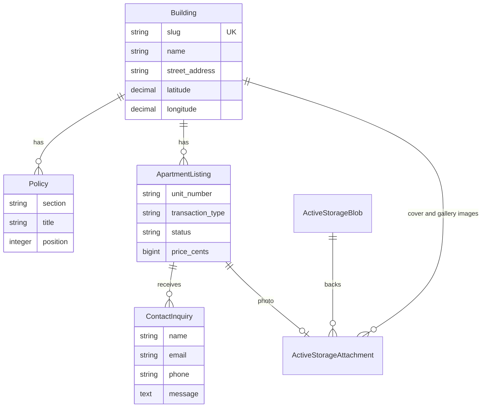

# Building Pages

Building Pages is a Rails technical assessment that presents a fictional
property-management portfolio. The application provides:

- A portfolio page with building cards, a featured image gallery, and building
  autocomplete.
- Individual, slug-addressed building pages.
- Active rental and sale inventory; inactive listings are intentionally hidden.
- General policies and additional building information.
- An embedded OpenStreetMap location map.
- An apartment-specific inquiry form with validation.
- Local HTML and plain-text email preview through Letter Opener Web.

The project is intentionally a focused demonstration rather than a complete
property-management system. There is no authentication, administration UI, or
production email/storage integration.

## Technology stack

- Ruby 3.4.10 and Rails 8.1.3
- PostgreSQL 16
- Docker and Docker Compose
- Server-rendered ERB, Turbo, Stimulus, and Importmap
- Propshaft and a plain CSS asset pipeline
- Active Storage for building, gallery, and listing images
- Action Mailer and `letter_opener_web` for local inquiry-email preview
- RSpec, Factory Bot, and Capybara for model, request, and mailer tests
- RuboCop Rails Omakase and Brakeman
- GitHub Actions for tests, quality checks, and a Docker image build

## Prerequisites

Only Docker with Docker Compose is required. A host installation of Ruby,
Bundler, Rails, or PostgreSQL is not required.

Confirm that the Docker daemon is running:

```sh
docker --version
docker compose version
```

## Setup from a clean clone

From the repository root:

```sh
cp .env.example .env
docker compose build
docker compose run --rm web bin/rails db:prepare
docker compose run --rm web bin/rails db:seed
docker compose up
```

On Windows PowerShell, use `Copy-Item .env.example .env` in place of `cp`.

Open <http://localhost:3000>. The Compose defaults are sufficient for local
development, so the copied `.env` can remain unchanged. The seed task is
idempotent and verifies its required image files and persisted attachments.
PostgreSQL data and development Active Storage files persist in the
`postgres_data` and `active_storage` named volumes.

Stop the application with `Ctrl+C`. To stop it from another terminal without
deleting its data:

```sh
docker compose down
```

## Demo paths

| Purpose | Path |
| --- | --- |
| Building portfolio | <http://localhost:3000/> or <http://localhost:3000/buildings> |
| Example building | <http://localhost:3000/buildings/one-sutton-place> |
| Local email interface | <http://localhost:3000/letter_opener> |

To exercise the inquiry flow:

1. Open the example building page.
2. Choose **Schedule a Visit** on any active apartment.
3. Complete the required name, email, and message fields, then submit.
4. Confirm the success message on the building page.
5. Open `/letter_opener` and select the newest message to inspect both its HTML
   and plain-text parts.

`/letter_opener` is mounted only in development. It captures mail locally and
does not send a real email.

Autocomplete is available on the portfolio page. Enter at least two characters
from a building name, neighborhood, street address, or city. Results are
debounced, limited to eight, and link to the matching slug-addressed page.

## Tests and quality checks

Prepare the test database once, then run each requested check in its own
container:

```sh
docker compose run --rm -e RAILS_ENV=test web bin/rails db:prepare
docker compose run --rm web bundle exec rspec
docker compose run --rm web bin/rubocop
docker compose run --rm web bin/brakeman --no-pager
```

RSpec currently covers model rules, portfolio and building responses,
autocomplete queries, active-inventory filtering, inquiry persistence and
validation, and the generated mail. The suite uses request-level HTML
inspection; it does not currently execute Stimulus behavior in a real browser.

GitHub Actions runs on every push and pull request. Its test job starts
PostgreSQL 16, prepares the test database, and runs RSpec, RuboCop, and
Brakeman. A separate job verifies that the application Docker image builds.

## Data model



Active Storage attachments are polymorphic. A building has one cover image and
many gallery images; an apartment listing has one photo. Contact inquiries
belong to a specific active apartment listing.

## Architecture decisions

### Rails monolith instead of a React frontend

This assessment is primarily server-rendered content, relational data, forms,
and email. A Rails monolith keeps routing, validation, persistence, rendering,
and mail delivery in one deployable application. Turbo preserves fast
navigation, while small Stimulus controllers handle the menu, gallery, dialog,
and autocomplete interactions without adding a separate API, Node build, or
duplicated client-side domain logic.

### PostgreSQL

PostgreSQL provides production-oriented relational constraints, transactions,
decimal coordinate types, indexes, and case-insensitive search behavior. Using
the same database family locally and in CI also avoids differences that can
occur when a lightweight development database is substituted.

### Prices stored in cents

`ApartmentListing#price_cents` is an integer so currency values do not acquire
binary floating-point rounding errors. Formatting converts cents to display
dollars at the presentation boundary. The demo assumes one currency (USD);
multi-currency support is not implemented.

### Stored coordinates instead of runtime geocoding

Latitude and longitude are stored on each building and supplied by the seed
data. This makes page rendering deterministic, avoids API keys, rate limits,
network latency, and address ambiguity, and allows a visible fallback when
coordinates are absent. Address-to-coordinate geocoding and coordinate
maintenance are not implemented.

### OpenStreetMap embed

The building page derives an OpenStreetMap embed URL from stored coordinates.
This provides a lightweight map without a client SDK or provider credential.
The map still depends on the visitor being able to reach OpenStreetMap; the
application displays the address fallback when coordinates are unavailable.

### Active Storage on local disk

Local disk storage keeps the Docker demonstration self-contained, and the
Compose volume preserves seeded files between container runs. This is demo
configuration, not a production durability or multi-instance strategy.
Production should use object storage with appropriate retention, access, and
delivery configuration.

### Synchronous local mail delivery

The inquiry controller uses `deliver_now` so the local demonstration creates a
Letter Opener message before the success redirect, making the result immediately
inspectable. This also means mail generation is on the request path. Production
should use `deliver_later`, a durable Active Job queue and workers, retry and
failure handling, and a configured transactional SMTP or email API provider.
Those production delivery pieces are not implemented here.

### PostgreSQL `ILIKE` autocomplete

Autocomplete searches a small, single-portfolio data set through a
Ransack-generated PostgreSQL `ILIKE` query. It searches four allowed columns,
escapes SQL wildcard input, requires two characters, and returns at most eight
ordered results. Elasticsearch or Algolia would add an external service,
synchronization, credentials, and operational overhead without improving this
demo's scale. Larger portfolios or relevance-heavy search could justify a
dedicated search system later.

## Assumptions

- The application represents a single property-management portfolio.
- Authentication, authorization, and a property-manager administration UI are
  outside the assessment scope.
- All seeded buildings, addresses, policies, apartment listings, prices, and
  contact details are fictional demonstration data.
- The inquiry recipient is read from `CONTACT_RECIPIENT_EMAIL`; its checked-in
  default is a non-deliverable `.test` address.
- The demo uses USD display formatting and does not model a currency field.

## Accessibility and responsive behavior

The layout is fluid, with implemented breakpoints for mobile (`<= 680px`),
tablet/smaller desktop (`681-900px`), desktop (`> 900px`), and a wide-screen
gallery enhancement (`>= 1320px`). The primary targets are modern browsers at
approximately 375px mobile, 768px tablet, and 1440px desktop widths; older
browsers without native `<dialog>` support are not explicitly supported.

Interactive controls use native buttons, visible labels, focus styles, and ARIA
state where applicable:

- **Menu:** `Tab` focuses the button and `Enter` or `Space` toggles it. `Escape`
  and an outside click close the drawer, and closing returns focus to the menu
  button. The drawer is not a modal and does not trap focus.
- **Inquiry dialog:** the native modal dialog provides tab containment and
  `Escape` dismissal in supporting browsers. The close button is keyboard
  accessible, and closing restores focus to the listing button that opened it.
  A `<noscript>` unit selector supports form submission when JavaScript is
  disabled.
- **Autocomplete:** `ArrowDown` and `ArrowUp` cycle through results, `Enter`
  follows the active result, and `Escape` dismisses the list. `Tab` follows the
  normal page order and dismisses results when focus leaves the component.
  Combobox/listbox roles and active-descendant state expose selection to
  assistive technology.
- **Gallery and motion:** gallery controls are buttons, the gallery track can
  receive keyboard focus, autoplay pauses on hover/focus, and reduced-motion
  preferences disable autoplay and smooth scrolling.

These behaviors are implemented, but full assistive-technology review and
browser-executed keyboard tests remain future work.

## Trade-offs and future improvements

- Add authentication, role-based authorization, and property-manager CRUD for
  buildings, policies, listings, and images.
- Move inquiry email to background jobs with worker deployment, retries,
  idempotency, and delivery-status visibility.
- Configure a transactional SMTP or email API provider, verified sender domain,
  bounce handling, and production secrets.
- Paginate the portfolio and listing collections as the data set grows.
- Move Active Storage to production object storage and add image lifecycle and
  CDN policies.
- Add an explicit geocoding workflow with provider selection, validation,
  retries, and a manual coordinate override.
- Add fragment/query caching, structured logging, error reporting, metrics,
  uptime checks, and alerting.
- Add full browser-level JavaScript tests for menu, dialog, gallery,
  autocomplete, focus management, responsive layouts, and reduced motion.

## Repository review

For assessment review, the GitHub repository must either be public or be shared
with the GitHub username requested by the reviewer. Verify access from an
account other than the repository owner before submission.

Do not commit private credentials, API keys, SMTP passwords, production
addresses, `.env`, Rails master keys, or other secrets. `.env.example` contains
only safe local placeholders; keep real values in ignored environment files or
the deployment platform's secret store.
